# Azure: starred interview questions

61 answers from `questions.txt`, with the original question numbers. Open in a Markdown preview with Mermaid support. Read the diagram first, then the short notes below it. Diagrams show logical flows; DNS and identity arrows are separate from application traffic.

**Personal-experience questions:** examples and `[placeholders]` are preparation prompts. Replace them with your actual implementation, role, and results.

**Jump to:** [Networking](#networking) · [Private connectivity](#private-connectivity) · [Application delivery](#application-delivery) · [Compute](#compute) · [AKS](#aks) · [Storage](#storage) · [Databases](#databases) · [Identity](#identity) · [Security](#security) · [Monitoring](#monitoring) · [Integration](#integration) · [Terraform and pipelines](#terraform-and-pipelines) · [Scenarios](#scenarios)

## Project architecture

### 1. Explain the Azure architecture of your current project. What did you personally implement?

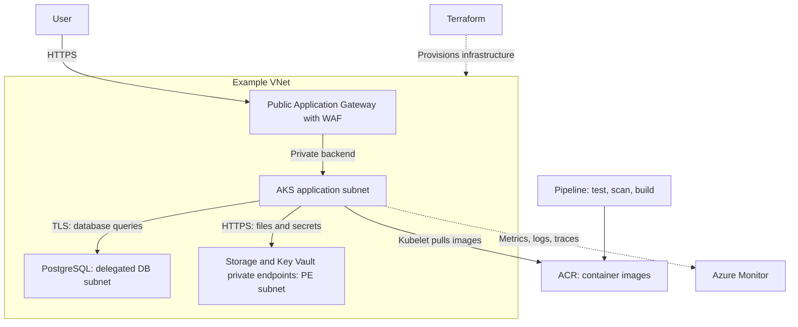

- **How / use:** This is an example architecture: a public entry point serves an application whose data services use private connectivity.
- **What it solves:** Separates public traffic, application compute, and data access; IaC makes environments repeatable.
- **Practice / your answer:** Name your real services and subnets, explain one request, then say: “I personally implemented `[modules / identity / pipeline / monitoring]`; the result was `[verified outcome]`.” Remove components you did not use.

## Networking

### 11. What is a VNet, what is a subnet, and how do you plan their address spaces?

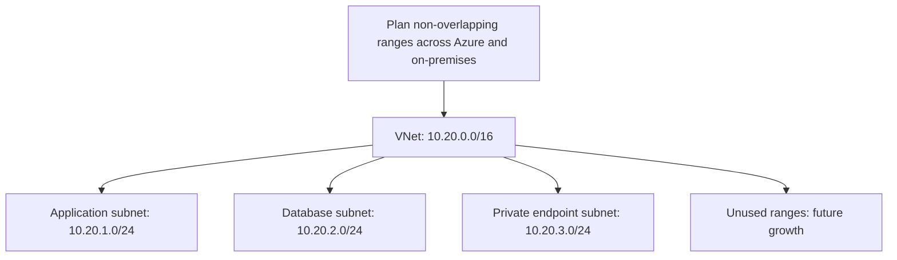

- **How / use:** A VNet is your logical private network. Subnets divide its IP range for workloads, routing, and security rules.
- **What it solves:** Organizes connectivity and reserves capacity. A subnet alone does not block another subnet.
- **Practice:** Avoid overlaps with networks you may connect. Size for AKS networking mode, scaling, and upgrades; respect service delegation requirements. Azure reserves five addresses in each subnet: a `/24` has 256 total, 251 assignable.

### 14. How do two VMs in different subnets of the same VNet communicate? Is peering required?

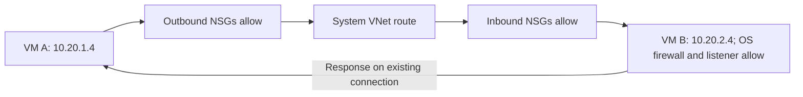

- **How / use:** Azure routes private traffic between subnets in the same VNet automatically. Peering connects separate VNets and is unnecessary here.
- **What it solves:** Lets application tiers communicate without public IPs.
- **Practice:** Check effective routes, source outbound and destination inbound NSGs, OS firewall, and listening port. A UDR can redirect the path through a firewall. [Routing reference](https://learn.microsoft.com/en-us/azure/virtual-network/virtual-networks-udr-overview).

### 16. What is an NSG? Explain inbound rules, outbound rules, priorities, and default rules.

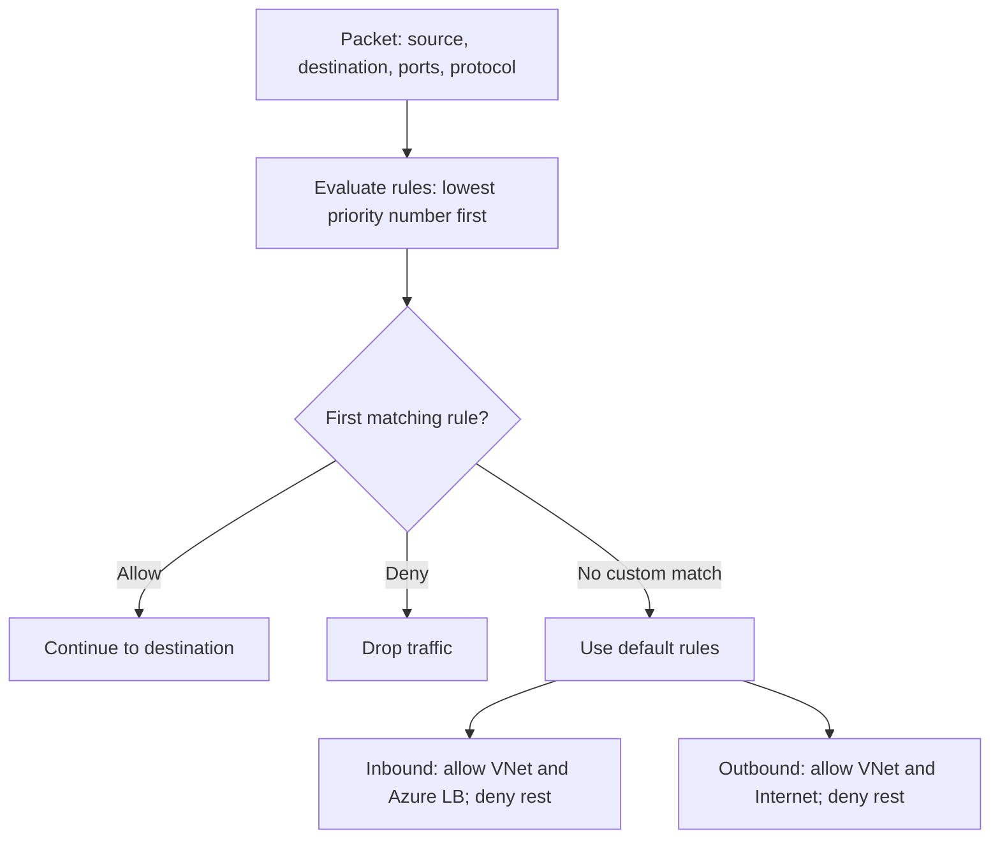

- **How / use:** An NSG filters Layer 3/4 traffic at a subnet or NIC. Custom priorities are `100–4096`; lower numbers win. Where both NSGs apply, both must allow traffic.
- **What it solves:** Restricts which sources can reach which ports. It does not inspect HTTP paths or create an internet route.
- **Practice:** Allow only required flows, then deny unwanted access. NSGs are stateful: response traffic for an allowed connection needs no separate return rule; rule changes may not terminate existing connections. [NSG reference](https://learn.microsoft.com/en-us/azure/virtual-network/network-security-groups-overview).

### 20. What are system routes and user-defined routes? How does Azure select a route?

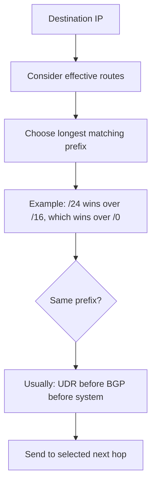

- **How / use:** Azure supplies system routes. UDRs are your subnet-associated routes, commonly used to send traffic through a firewall or network virtual appliance. BGP routes can come from gateways.
- **What it solves:** Controls the path traffic follows; an NSG separately controls whether traffic is allowed.
- **Practice:** Inspect NIC effective routes and the return path. The diagram is the general rule: Azure has preferred VNet/peering route behavior, and service-endpoint routes cannot be overridden. A `0.0.0.0/0` firewall UDR does not automatically override more-specific private routes. [Route-selection details](https://learn.microsoft.com/en-us/azure/virtual-network/virtual-networks-udr-overview).

### 21. What does NAT Gateway do? Can it accept unsolicited inbound connections?

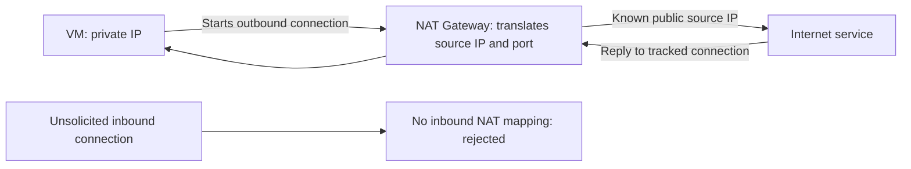

- **How / use:** Associate NAT Gateway with a subnet for explicit outbound connectivity using its public IPs or prefix. A VM needs no public IP.
- **What it solves:** Provides predictable outbound IPs and scalable source NAT. It does not provide inbound publishing or application filtering.
- **Practice:** Plan explicit egress and monitor SNAT capacity. A UDR to a firewall/gateway can take precedence. New VNets using API versions after March 31, 2026 default to private subnets; do not assume automatic outbound access. [NAT overview](https://learn.microsoft.com/en-us/azure/nat-gateway/nat-overview), [egress routing](https://learn.microsoft.com/azure/networking/design-guide/outbound-egress).

## Private connectivity

### 26. What problem does a private endpoint solve?

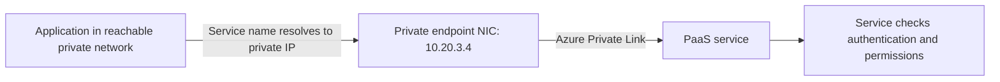

- **How / use:** A private endpoint gives a supported service subresource a private IP in your subnet. Private Link connects that endpoint to the service; the PaaS service itself stays managed outside your subnet.
- **What it solves:** Private access from VNets or connected on-premises networks without using the service's public endpoint.
- **Practice:** Configure DNS, approve the endpoint, grant data permissions, and configure public access separately. Private networking alone grants no data access. [Private endpoint reference](https://learn.microsoft.com/en-us/azure/private-link/private-endpoint-overview).

### 28. Compare a service endpoint and a private endpoint.

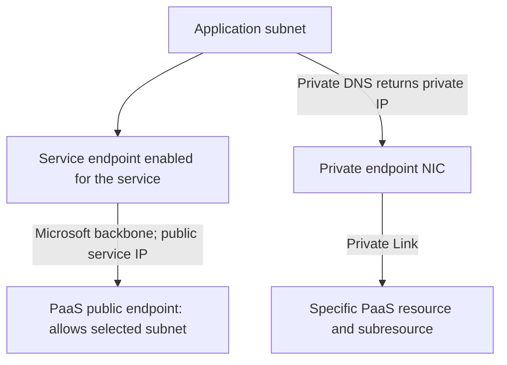

- **How / use:** A service endpoint identifies an allowed VNet subnet to a service's public endpoint; it does not allocate a private service IP. A private endpoint allocates a private IP for a particular service connection.
- **What it solves:** Service endpoints restrict public-endpoint access to selected subnets. Private endpoints support private-IP access, including from routed on-premises networks.
- **Practice:** Service endpoints need a matching service firewall rule. Private endpoints need DNS and approval. Both still need authentication; use Private Link when private-only access is required. [Service endpoints](https://learn.microsoft.com/en-us/azure/virtual-network/virtual-network-service-endpoints-overview), [private endpoints](https://learn.microsoft.com/en-us/azure/private-link/private-endpoint-overview).

### 30. A VM is in subnet A and a Storage private endpoint is in subnet B. Explain the complete connection flow.

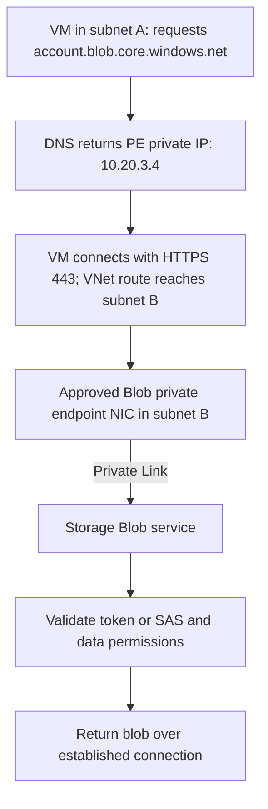

- **How / use:** DNS selects the private destination; routing carries packets to it. Same-VNet subnets need no peering or NAT Gateway for this flow.
- **What it solves:** Allows a VM to access Blob Storage privately while keeping endpoint placement separate from compute.
- **Practice:** Verify client DNS, routes, applicable NSGs/firewalls, endpoint approval, and Blob data RBAC. NSG/UDR enforcement on the PE subnet depends on its private-endpoint network policy settings. [Storage private connectivity](https://learn.microsoft.com/en-us/azure/storage/common/storage-private-endpoints).

### 31. What happens during DNS resolution when an application accesses Storage through a private endpoint?

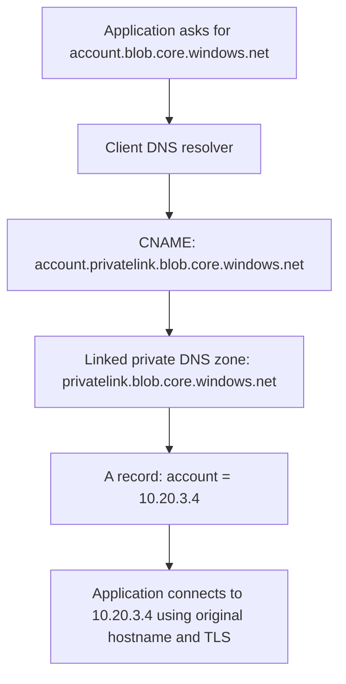

- **How / use:** The public name aliases to a `privatelink` name; the client's private DNS resolution returns the endpoint's private IP.
- **What it solves:** Keeps the normal service hostname while choosing a private connection. The DNS zone is linked to a VNet; it is not placed in a subnet.
- **Practice:** Use the original Storage hostname, not a hardcoded IP or `privatelink` URL. Custom/on-premises DNS needs forwarding through an Azure resolver path; peering alone does not provide DNS-zone visibility. [Storage DNS flow](https://learn.microsoft.com/en-us/azure/storage/common/storage-private-endpoints), [DNS integration](https://learn.microsoft.com/en-us/azure/private-link/private-endpoint-dns-integration).

### 34. Does creating a private endpoint automatically disable the service’s public access?

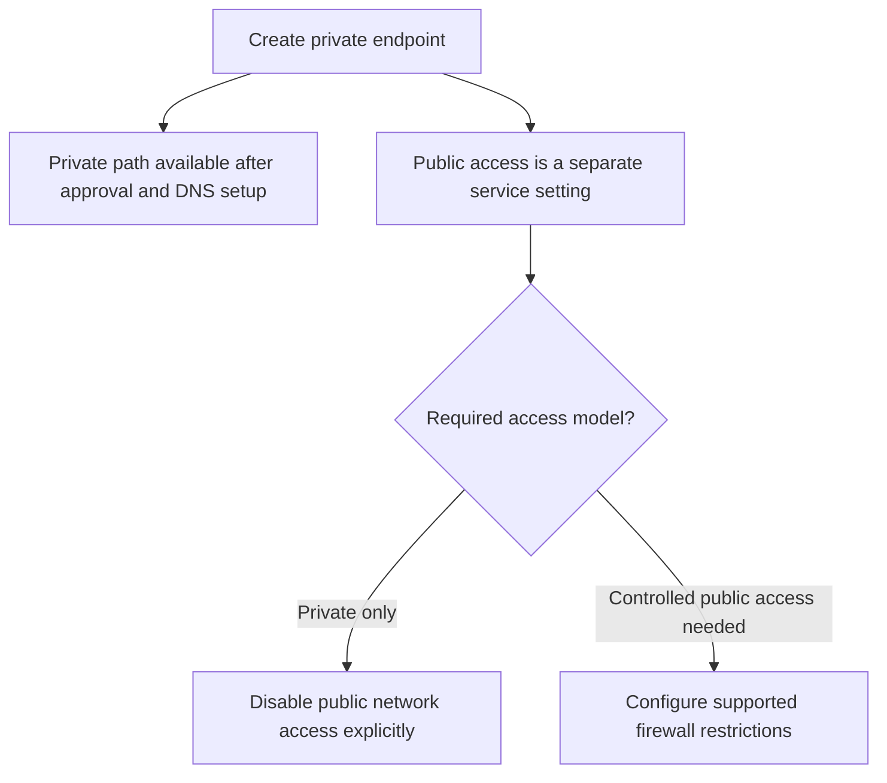

- **How / use:** No. Creating a private endpoint adds a private access path; public access must be reviewed independently.
- **What it solves:** Separating these settings lets you migrate clients before closing the public path.
- **Practice:** Test every application and deployment agent over the private path, disable public access as intended, then verify unauthorized public access is denied. [Storage endpoint behavior](https://learn.microsoft.com/en-us/azure/storage/common/storage-private-endpoints).

## Application delivery

### 36. Compare Azure Load Balancer, Application Gateway, Front Door, and Traffic Manager.

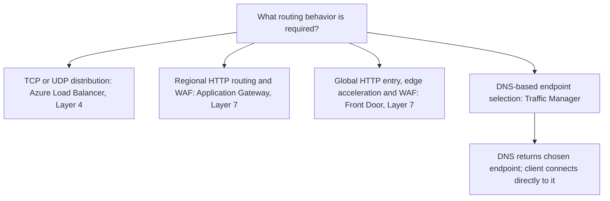

- **How / use:** Load Balancer distributes flows without URL inspection. Application Gateway and Front Door proxy web requests. Traffic Manager answers DNS queries and does not proxy application traffic.
- **What it solves:** Selects healthy backends at the transport, web-request, or DNS layer.
- **Practice:** Choose by protocol, regional/global scope, TLS/WAF needs, and health checks. Combine services only when each has a clear purpose. [Service comparison](https://learn.microsoft.com/en-us/azure/architecture/guide/technology-choices/load-balancing-overview).

### 41. Trace a request from a user through DNS, Azure networking, AKS ingress, and finally an application pod.

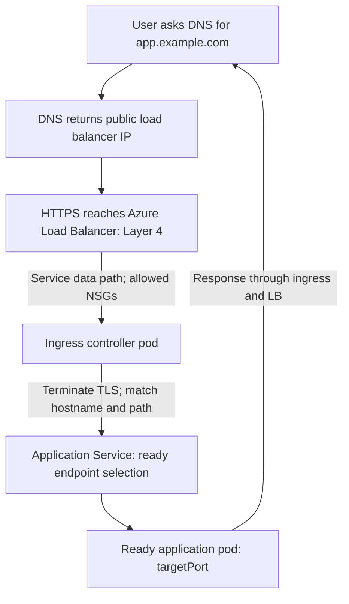

- **How / use:** Example: a `LoadBalancer` Service exposes an ingress controller; an Ingress resource configures its host/path rules. The controller forwards to application backends.
- **What it solves:** One external web entry can route multiple applications. The Service is a logical abstraction; some controllers connect directly to pod endpoints.
- **Practice:** Check DNS, LB probes, NSGs, controller logs, ingress rules, Service selectors, EndpointSlices, and pod readiness. An Application Gateway ingress design uses a different path; do not put every ingress product into one flow.

### 45. An application returns 502 Bad Gateway. How would you identify the failing component?

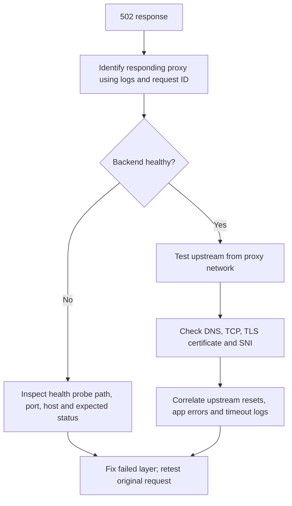

- **How / use:** A 502 usually means a gateway could not get a valid upstream response. Identify whether Front Door, Application Gateway, ingress, or another proxy generated it.
- **What it solves:** Avoids treating every gateway error as an application code failure.
- **Practice:** Compare direct-backend and gateway requests with the same host/path, where permitted. Check recent deployments, healthy endpoints, TLS, and dependency errors; verify recovery through the user's full path.

## Compute

### 46. When would you choose a VM, App Service, Azure Functions, Container Apps, or AKS?

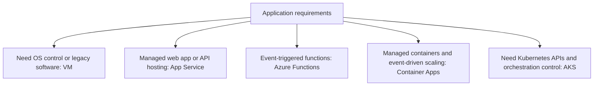

- **How / use:** VM gives OS control; App Service hosts web code; Functions runs triggered functions; Container Apps manages container execution; AKS provides managed Kubernetes.
- **What it solves:** Matches operational effort and platform capability to the workload.
- **Practice:** Start with the simplest service meeting networking, scaling, runtime, reliability, and cost requirements. Use AKS when Kubernetes control justifies managing workloads and node-pool lifecycle. [Compute selection](https://learn.microsoft.com/en-us/azure/architecture/guide/technology-choices/compute-decision-tree).

### 53. How would you troubleshoot an unreachable VM?

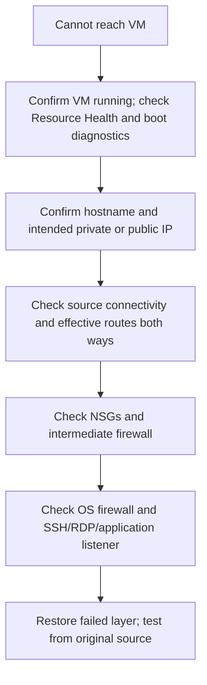

- **How / use:** Establish whether this is boot failure, network reachability, a closed port, or login failure. Use Network Watcher connection troubleshooting/IP flow verification for the Azure path.
- **What it solves:** Isolates the failed layer before changing access rules.
- **Practice:** A private VM needs VPN/ExpressRoute, a suitable jump host, or Bastion for administration. Use serial console or Run Command when available; failed ping alone does not prove the VM is down.

### 54. How would you investigate high CPU, memory pressure, or disk latency on a VM?

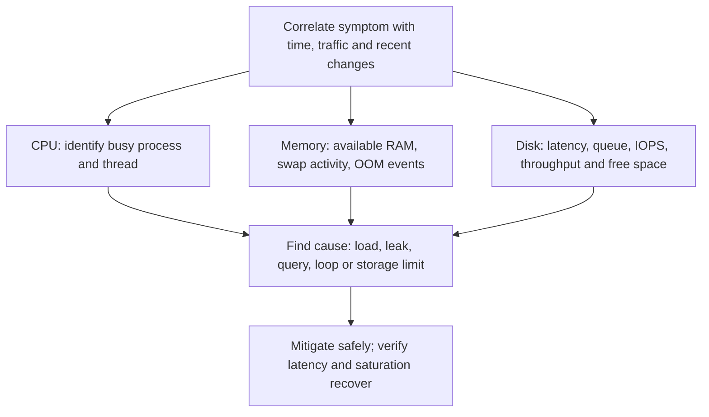

- **How / use:** On Linux: `top`/`pidstat -u 1 5` identify CPU consumers; `free -h` and `vmstat 1 5` show memory/swap pressure; `iostat -xz 1 5` shows device latency/queues; `df -h` and `df -i` check space and inodes.
- **What it solves:** Distinguishes compute pressure, memory exhaustion, storage saturation, and capacity exhaustion. Low free RAM alone can reflect useful cache; load average is not CPU utilization.
- **Practice:** Correlate guest evidence with VM/disk limits and application metrics. Collect evidence before restarting; roll back, tune, or scale based on the cause, then confirm sustained recovery. Guest memory metrics require guest monitoring.

### 58. What is the difference between App Service VNet integration and an App Service private endpoint?

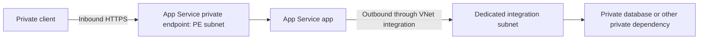

- **How / use:** VNet integration gives the app outbound access into a VNet. A private endpoint gives clients inbound private access to the app.
- **What it solves:** An app can privately receive requests and privately call dependencies; these are two separate requirements.
- **Practice:** Use separate subnets for integration and private endpoints. Configure DNS and public-access settings; verify supported plan features and outbound routing settings. [VNet integration](https://learn.microsoft.com/en-us/azure/app-service/overview-vnet-integration), [private endpoints](https://learn.microsoft.com/en-us/azure/app-service/overview-private-endpoint).

## AKS

### 61. What does Azure manage in AKS, and what remains your responsibility?

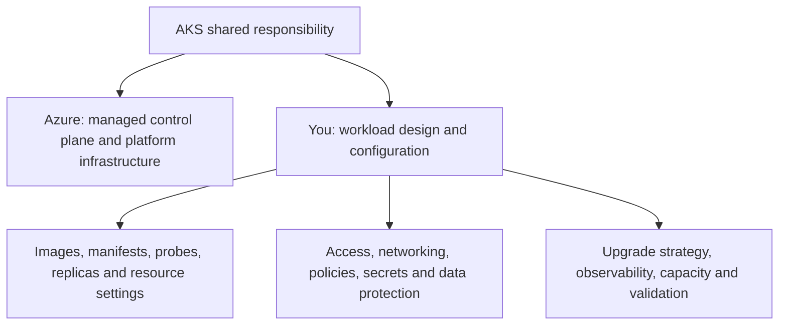

- **How / use:** Azure operates the managed Kubernetes control plane. You own application reliability and security; node operations and upgrade automation depend on AKS mode and settings.
- **What it solves:** Reduces cluster-platform maintenance while retaining Kubernetes capabilities.
- **Practice:** Plan supported versions, maintenance windows, node-image updates, least privilege, backup/restore, and resilient workloads. A managed control plane does not make an application highly available automatically. [AKS concepts](https://learn.microsoft.com/en-us/azure/aks/core-aks-concepts), [reliability](https://learn.microsoft.com/en-us/azure/reliability/reliability-aks).

### 65. Explain how AKS authenticates to ACR to pull an image. Which identity and permissions are involved?

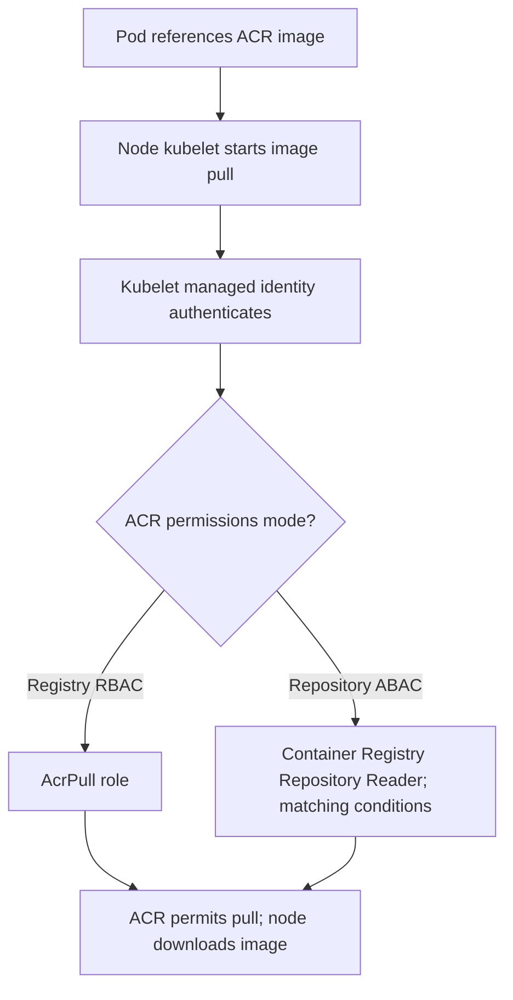

- **How / use:** The kubelet identity pulls images; it is distinct from an application's Workload Identity and may differ from the cluster control-plane identity.
- **What it solves:** Avoids storing registry administrator credentials in application deployments.
- **Practice:** For registry RBAC, `--attach-acr` can assign `AcrPull`. For ABAC-enabled ACR, manually assign `Container Registry Repository Reader`; `--attach-acr` is not supported for that mode. Also verify registry DNS and network reachability. [AKS–ACR integration](https://learn.microsoft.com/en-us/azure/aks/cluster-container-registry-integration).

### 66. How would you troubleshoot ImagePullBackOff?

```mermaid
flowchart TD
    E["kubectl describe pod: inspect pull event"] --> T{"Error type?"}
    T -->|"Not found"| N["Check registry, repository, tag or digest"]
    T -->|"Unauthorized or denied"| I["Check kubelet identity and ACR role mode"]
    T -->|"Timeout or DNS"| D["Check node DNS, ACR endpoint and egress"]
    T -->|"Platform mismatch"| P["Check image OS and architecture"]
    N --> V["Correct cause; verify pull and pod readiness"]
    I --> V
    D --> V
    P --> V
```

- **How / use:** `ImagePullBackOff` means Kubernetes is delaying retries after image-pull failures. The event contains the useful underlying error.
- **What it solves:** Separates bad image references, permissions, and network failures.
- **Practice:** Check from the node's network context, not only your laptop. For private ACR, verify registry and data-endpoint DNS/routing. Use `az aks check-acr` as an additional check; avoid enabling ACR admin credentials as a shortcut. [Image-pull troubleshooting](https://learn.microsoft.com/en-us/troubleshoot/azure/azure-kubernetes/extensions/cannot-pull-image-from-acr-to-aks-cluster).

### 67. How would you troubleshoot a pod in Pending, CrashLoopBackOff, or OOMKilled state?

```mermaid
flowchart TD
    P["Inspect pod status and events"] --> S{"Observed state?"}
    S -->|"Pending"| A["Scheduling events: requests, capacity, taints, affinity, PVC"]
    S -->|"CrashLoopBackOff"| B["Previous logs, exit code, command, config and probes"]
    S -->|"OOMKilled"| C["Memory limit, usage peak, leak or node pressure"]
    A --> F["Fix identified cause"]
    B --> F
    C --> F
    F --> V["Verify Ready pods, stable restart count and healthy requests"]
```

- **How / use:** Start with `kubectl describe pod <pod> -n <namespace>`. For crashes, use `kubectl logs <pod> -n <namespace> -c <container> --previous`; `kubectl top pod` helps with current usage when metrics are available.
- **What it solves:** Distinguishes placement failure from startup failure and memory termination. A current metrics sample can miss a brief OOM peak.
- **Practice:** Pending may also involve volume or image/container initialization, so follow events. Tune requests/limits from evidence, fix leaks and configuration, and check historical memory plus node events before simply increasing limits.

### 70. Compare readiness, liveness, and startup probes.

```mermaid
flowchart TD
    C["Container starts"] --> S{"Startup probe succeeds?"}
    S -->|"Not yet: within budget"| S
    S -->|"Failure threshold reached"| X["Restart container according to restart policy"]
    S -->|"Yes"| R["Readiness probe: may this pod receive traffic?"]
    S -->|"Yes"| L["Liveness probe: must this container restart?"]
    R -->|"Fails"| E["Mark unready; remove from normal Service traffic"]
    L -->|"Failure threshold reached"| X
```

- **How / use:** Startup protects slow initialization; when configured, readiness and liveness wait for it. Readiness controls traffic eligibility. Liveness detects a stuck container and triggers restart after its failure threshold.
- **What it solves:** Prevents traffic reaching unready pods and recovers containers that cannot make progress.
- **Practice:** Use lightweight endpoints and realistic timeouts. Avoid making liveness depend on a shared database: an outage could restart every replica. Readiness failure itself does not restart a container. [Probe behavior](https://kubernetes.io/docs/concepts/workloads/pods/probes/).

### 72. Walk through an AKS upgrade, including preparation, node draining, surge capacity, and validation.

```mermaid
flowchart TD
    P["Check supported target, removed APIs, add-ons and recovery plan"] --> T["Test in staging; check replicas, PDBs, quota and free IPs"]
    T --> C["Upgrade control plane, then node pools in supported order"]
    C --> S["Add surge capacity"]
    S --> D["Cordon and drain old node; evict pods within PDB"]
    D --> R["Pods reschedule and become Ready; replace or reimage old node"]
    R --> N{"More nodes?"}
    N -->|"Yes"| D
    N -->|"No"| V["Validate versions, system pods, app traffic and dependencies"]
```

- **How / use:** A rolling upgrade replaces node capacity while workloads move to healthy nodes. Surge uses extra temporary capacity; PDBs limit voluntary disruption.
- **What it solves:** Keeps Kubernetes supported while reducing maintenance impact.
- **Practice:** Plan a window, drain timeout, surge size, quota/IP headroom, and representative smoke tests. A restrictive PDB can block drain; fix replica/capacity constraints. Do not assume in-place Kubernetes downgrade is a recovery option; plan workload restoration or cluster replacement. [Upgrade guidance](https://learn.microsoft.com/en-us/azure/aks/upgrade-cluster).

### 74. How can an AKS pod access Key Vault or Storage without embedding credentials?

```mermaid
flowchart TD
    P["Pod uses annotated Kubernetes ServiceAccount"] --> S["Projected OIDC service-account token"]
    S --> E["Entra validates federated trust: issuer, subject and audience"]
    E --> T["Exchange for Azure access token as mapped identity"]
    T --> A["SDK calls Key Vault or Storage over permitted network path"]
    A --> R["Service evaluates identity's data-plane role"]
```

- **How / use:** Enable AKS OIDC issuer and Workload Identity, create federation to a user-assigned managed identity or app registration, and configure the ServiceAccount and pod label. A compatible Azure SDK performs token exchange.
- **What it solves:** Replaces embedded secrets with short-lived tokens and per-workload identities.
- **Practice:** Grant only required roles, such as Key Vault Secrets User or Storage Blob Data Reader, at a narrow scope. Federation is authentication; RBAC and private DNS/connectivity are separate requirements. [Workload Identity](https://learn.microsoft.com/en-us/azure/aks/workload-identity-overview).

## Storage

### 76. Compare Blob Storage, Azure Files, and managed disks.

```mermaid
flowchart TD
    N["What storage interface does the workload need?"] --> B["Objects via HTTP/API: Blob Storage"]
    N --> F["Shared filesystem via SMB or supported NFS: Azure Files"]
    N --> D["Block device for VM OS or application: managed disk"]
    B --> O["Images, backups, documents and data lakes"]
    F --> S["Shared directories and migrated file shares"]
    D --> V["Format and mount within guest OS"]
```

- **How / use:** Blob stores objects in containers; Files exposes managed file shares; managed disks provide persistent block storage to VMs and supported container storage integrations.
- **What it solves:** Each provides a different application interface; object storage is not a normal VM disk.
- **Practice:** Choose by access protocol, sharing, latency, throughput, durability, and recovery needs. Shared-disk support is specialized and requires a cluster-aware design; do not assume any disk can be mounted read/write by many machines. [Storage overview](https://learn.microsoft.com/en-us/azure/storage/common/storage-introduction).

### 80. Compare LRS, ZRS, GRS, and GZRS. What do the read-access variants add?

```mermaid
flowchart TD
    D["Storage redundancy choice"] --> L["LRS: synchronous copies within one primary-region location"]
    D --> Z["ZRS: synchronous copies across three primary-region zones"]
    L -->|"Add asynchronous region replication"| G["GRS: secondary region uses LRS"]
    Z -->|"Add asynchronous region replication"| H["GZRS: secondary region uses LRS"]
    G --> R["RA-GRS: read secondary endpoint before failover"]
    H --> S["RA-GZRS: read secondary endpoint before failover"]
```

- **How / use:** LRS protects against local hardware failures; ZRS adds zone resilience. GRS/GZRS add a secondary region; RA variants allow reading that secondary while the primary remains active.
- **What it solves:** Balances cost against zone and regional failure protection. Asynchronous geo-replication can leave recent writes absent in the secondary.
- **Practice:** Match redundancy to RPO/RTO and service/region support. Reading the secondary can return stale data; writing there requires a supported failover. Replication does not replace backups/versioning against logical deletion. [Redundancy details](https://learn.microsoft.com/en-us/azure/storage/common/storage-redundancy).

### 82. Compare account keys, SAS tokens, and Microsoft Entra authentication.

```mermaid
flowchart TD
    A["Application requests Storage data"] --> K["Account key: signs requests with broad shared credential"]
    A --> S["SAS: signed permission, resource and expiry constraints"]
    A --> E["Entra: identity obtains access token"]
    E --> R["Storage authorizes using data-plane RBAC"]
    S --> U["For Blob: prefer user delegation SAS when SAS is needed"]
```

- **How / use:** Keys are powerful shared credentials. SAS grants bounded delegated access to whoever possesses it. Entra uses identity-based tokens and permissions.
- **What it solves:** Entra supports auditable workload access; SAS suits temporary delegated transfers without granting broad standing access.
- **Practice:** Prefer managed identity with Entra where supported. Keep SAS short-lived, HTTPS-only, and narrowly scoped; user delegation SAS avoids signing with an account key. Never log keys or SAS URLs, and disable Shared Key access where compatible. [Authorization options](https://learn.microsoft.com/en-us/azure/storage/common/authorize-data-access).

### 84. How would you make a storage account accessible only from approved workloads?

```mermaid
flowchart TD
    A["Approved workload"] --> D["Private DNS resolves Storage to private endpoint"]
    D --> P["Approved PE; reachable network path"]
    P --> I["Entra identity with narrow data role"]
    I --> S["Storage permits required operation"]
    U["Unapproved public client"] --> B["Public network access disabled"]
    N["Private client without permission"] --> X["Data authorization denied"]
```

- **How / use:** Combine a private endpoint and disabled public access with a dedicated workload identity and scoped data RBAC.
- **What it solves:** Limits both where requests come from and what each caller can do. A private endpoint alone does not identify an approved workload.
- **Practice:** Create endpoints for each used subresource (`blob`, `file`, `dfs`, etc.), configure DNS, and test denied access too. Review keys, SAS, and exceptions so they do not bypass intended identity restrictions. [Network restrictions](https://learn.microsoft.com/en-us/azure/storage/common/storage-network-security), [data authorization](https://learn.microsoft.com/en-us/azure/storage/common/authorize-data-access).

### 85. An application receives 403 when accessing Blob Storage. What would you check?

```mermaid
flowchart TD
    E["Capture Storage error code and request ID"] --> C{"Which branch fits the evidence?"}
    C -->|"Token or signature"| T["Tenant, audience, expiry, SAS signature and clock"]
    C -->|"Permission mismatch"| R["Actual caller, Blob data role, scope and SAS permissions"]
    C -->|"Network authorization"| N["Public access, firewall, DNS and private endpoint"]
    T --> V["Correct narrow cause; retry same operation as same identity"]
    R --> V
    N --> V
```

- **How / use:** A 403 can result from identity permissions, SAS restrictions, or a service network rule; it is not always an RBAC problem.
- **What it solves:** Uses the service error to avoid granting unnecessary broad permissions.
- **Practice:** Check `AuthorizationPermissionMismatch`, failed authentication details, data-role propagation, and ADLS ACLs where applicable. Test from the failing workload itself; your local CLI may use another identity and network. [403 troubleshooting](https://learn.microsoft.com/en-us/troubleshoot/azure/azure-storage/blobs/authentication/storage-troubleshoot-403-errors).

## Databases

### 88. Compare Azure SQL Database, SQL Managed Instance, SQL Server on a VM, and Azure Database for PostgreSQL.

```mermaid
flowchart TD
    R["Engine and compatibility requirements"] --> M["Microsoft SQL / T-SQL ecosystem"]
    M --> D["Database-focused managed PaaS: Azure SQL Database"]
    M --> I["Higher SQL Server instance compatibility: SQL Managed Instance"]
    M --> V["Full OS and SQL Server control: SQL Server on VM"]
    R --> P["PostgreSQL engine and ecosystem: managed PostgreSQL Flexible Server"]
```

- **How / use:** SQL Database and Managed Instance reduce platform administration at different compatibility levels. SQL Server on a VM gives maximum control and maintenance responsibility. Azure Database for PostgreSQL runs the PostgreSQL engine.
- **What it solves:** Matches existing engine/features and migration requirements to an appropriate management model.
- **Practice:** Check feature compatibility, extensions, networking, HA, recovery, and cost. Managed services still require schema design, query tuning, access control, and restore testing. [Azure SQL comparison](https://learn.microsoft.com/en-us/azure/azure-sql/azure-sql-iaas-vs-paas-what-is-overview?view=azuresql), [PostgreSQL overview](https://learn.microsoft.com/en-us/azure/postgresql/flexible-server/overview).

### 90. How would AKS connect securely to PostgreSQL using private connectivity?

```mermaid
flowchart TD
    A["AKS application pod"] --> D["Database FQDN resolves privately"]
    D --> P{"Configured database network model?"}
    P -->|"VNet integration"| S["PostgreSQL dedicated delegated subnet"]
    P -->|"Private Link"| E["Approved private endpoint in PE subnet"]
    S --> T["TLS connection on TCP 5432"]
    E --> T
    T --> I["Database login and SQL grants authorize queries"]
```

- **How / use:** Pick a supported model: delegated-subnet private access, or Private Link on a server supporting that connectivity mode. These are alternative designs, not two mandatory hops.
- **What it solves:** Keeps database traffic private while preserving service hostname and TLS verification.
- **Practice:** Allow the actual pod/node source range required by the AKS networking mode. Configure DNS links/forwarding, port 5432, connection pooling, and restricted DB grants. Entra Workload Identity requires PostgreSQL Entra configuration and a corresponding database principal; Azure resource RBAC alone grants no SQL access. [VNet integration](https://learn.microsoft.com/en-us/azure/postgresql/network/concepts-networking-private), [Private Link](https://learn.microsoft.com/en-us/azure/postgresql/flexible-server/concepts-networking-private-link).

### 92. How would you troubleshoot a database connection timeout?

```mermaid
flowchart TD
    E["Connection timeout from application"] --> D{"FQDN resolves correctly?"}
    D -->|"No"| F["Fix DNS link, forwarding or stale record"]
    D -->|"Yes"| P{"TCP port reachable from workload?"}
    P -->|"No"| N["Check route, NSG, firewall, PE approval and server health"]
    P -->|"Yes"| T["Check TLS handshake, pool wait and connection limits"]
    T --> Q["Check server load and exact timeout stage"]
    F --> V["Retry connection and representative query"]
    N --> V
    Q --> V
```

- **How / use:** Test from the pod/VM running the app: resolve the hostname and test the DB port (`5432` PostgreSQL; SQL Database commonly `1433`, with additional requirements depending on connection policy).
- **What it solves:** Distinguishes network connection timeout from pool acquisition or query timeout. Explicit authentication rejection usually means the server was reached.
- **Practice:** Keep TLS enabled, inspect both client and server logs, and check connection counts. Increasing the timeout is useful only after understanding whether the delay is expected or a failure.

### 94. How would you investigate slow queries or high database CPU?

```mermaid
flowchart TD
    S["Correlate latency and CPU with workload changes"] --> Q["Rank expensive queries by total time and calls"]
    Q --> P["Inspect execution plan and row estimates"]
    P --> B["Check blocking, waits, I/O and connection pressure"]
    B --> F["Tune query, index, statistics, transaction or pool"]
    F --> V["Compare latency, throughput and CPU under similar load"]
```

- **How / use:** PostgreSQL: inspect `pg_stat_activity`, `pg_stat_statements` when enabled, and execution plans. Azure SQL: use Query Store and wait/plan evidence.
- **What it solves:** Finds expensive scans, poor plans, blocking, excessive calls, and resource bottlenecks before choosing a fix.
- **Practice:** `EXPLAIN ANALYZE` executes the query: use a safe environment or a carefully assessed query. Tune the largest measured cost, then validate; scaling adds capacity but may leave inefficient queries unchanged. [PostgreSQL query analysis](https://www.postgresql.org/docs/current/using-explain.html), [Query Store](https://learn.microsoft.com/en-us/sql/relational-databases/performance/monitoring-performance-by-using-the-query-store?view=sql-server-ver17).

## Identity

### 100. Explain authentication versus authorization using an Azure example.

```mermaid
flowchart LR
    A["Application identity"] -->|"Authenticate"| E["Entra ID: prove who you are; issue token"]
    E --> T["Application sends token to Blob service"]
    T -->|"Authorize"| R["Storage checks Blob data role at requested scope"]
    R --> Y["Allowed operation succeeds; missing permission is denied"]
```

- **How / use:** Authentication establishes identity. Authorization determines whether that identity may perform the requested operation.
- **What it solves:** A valid login can still be denied data access; identity and permission failures need different fixes.
- **Practice:** Check the actual token identity/tenant/audience, then its data-plane role and scope. Network access is another separate check. [Azure RBAC](https://learn.microsoft.com/en-us/azure/role-based-access-control/overview).

### 102. Compare a user, group, application registration, service principal, and managed identity.

```mermaid
flowchart TD
    U["User: human identity"] --> G["Group: collection for assigning access"]
    A["App registration: application definition"] --> S["Service principal: application's identity in a tenant"]
    M["Managed identity: Azure-managed workload identity"] --> P["Special service principal; Azure manages credentials"]
    G --> R["Assign suitable permissions"]
    S --> R
    P --> R
```

- **How / use:** Users represent people; groups simplify access management. An app registration defines an application; its service principal is the local tenant representation used for access. Managed identities remove manual credential management for supported workloads.
- **What it solves:** Gives humans and software separate, auditable identities.
- **Practice:** Use groups for human access and managed identity or federation for workloads. An app registration and a service principal are related objects, not interchangeable names. [Application objects](https://learn.microsoft.com/en-us/entra/identity-platform/app-objects-and-service-principals), [managed identities](https://learn.microsoft.com/en-us/entra/identity/managed-identities-azure-resources/overview).

### 103. Compare system-assigned and user-assigned managed identities.

```mermaid
flowchart TD
    M["Managed identity choice"] --> S["System-assigned: created on resource"]
    S --> L["Lifecycle tied to that resource; deleted with it"]
    M --> U["User-assigned: independent Azure resource"]
    U --> R["Attach to supported resources; survives their deletion"]
    L --> A["Both obtain tokens without storing app secrets"]
    R --> A
```

- **How / use:** System-assigned suits a resource-specific identity. User-assigned suits a stable identity provisioned before compute, or selectively reused across supported resources.
- **What it solves:** Avoids long-lived app credentials; user-assigned identities can preserve permissions when compute is replaced.
- **Practice:** Use separate identities for distinct workloads and environments. Sharing a user-assigned identity also shares its privileges and reduces caller separation; grant narrow roles. [Identity types](https://learn.microsoft.com/en-us/entra/identity/managed-identities-azure-resources/overview).

### 104. What three components make up an Azure role assignment?

```mermaid
flowchart TD
    P["Principal: who? Example: app managed identity"] --> A["Role assignment"]
    R["Role definition: what? Storage Blob Data Reader"] --> A
    S["Scope: where? One Blob container"] --> A
    A --> E["This identity can read blobs within that scope"]
```

- **How / use:** **Principal + role definition + scope.** A principal is a user, group, service principal, or managed identity.
- **What it solves:** Grants the required operation to the required identity over the required resources.
- **Practice:** Choose the narrowest practical scope. Permissions normally inherit from management group → subscription → resource group → resource, with service-specific child scopes where supported. [Role assignments](https://learn.microsoft.com/en-us/azure/role-based-access-control/role-assignments).

### 106. Compare Owner, Contributor, Reader, and User Access Administrator.

```mermaid
flowchart TD
    R["Common Azure resource roles"] --> O["Owner: manage resources and assign Azure roles"]
    R --> C["Contributor: manage resources; cannot normally assign Azure roles"]
    R --> V["Reader: view resource configuration"]
    R --> U["User Access Administrator: manage user access to Azure resources"]
```

- **How / use:** These are resource management/access administration roles. They are not Microsoft Entra directory roles.
- **What it solves:** Separates viewing, changing resources, and granting access.
- **Practice:** Use Contributor/Reader for appropriate duties and narrowly delegate role administration. These roles do not directly grant every data operation through Entra; privileged management rights may still enable indirect access such as key retrieval or role assignment. [Built-in roles](https://learn.microsoft.com/en-us/azure/role-based-access-control/built-in-roles/privileged).

### 107. Why might a storage account Contributor still be unable to read blobs using Entra authentication?

```mermaid
flowchart TD
    C["Storage account Contributor"] --> M["Can manage storage account configuration"]
    M --> B["Blob read using Entra token"]
    B --> Q{"Has Blob data-plane permission?"}
    Q -->|"No"| X["403: missing data access"]
    Q -->|"Storage Blob Data Reader at correct scope"| Y["Read allowed if other access checks pass"]
```

- **How / use:** Managing an account uses management-plane permissions. Reading blobs with Entra requires suitable data-plane permissions, such as Storage Blob Data Reader.
- **What it solves:** Keeps infrastructure management and application data access separately assignable.
- **Practice:** Assign the data role to the actual caller at container/account scope as needed; check propagation and network rules. Contributor may retrieve account keys, which is a separate access path; restrict Shared Key where appropriate. [Blob data roles](https://learn.microsoft.com/en-us/azure/storage/blobs/assign-azure-role-data-access).

### 110. Compare Azure RBAC and Azure Policy.

```mermaid
flowchart TD
    R["Request to create a resource"] --> A{"RBAC: may this identity create it at this scope?"}
    A -->|"No"| X["Authorization denied"]
    A -->|"Yes"| P{"Policy: is this configuration permitted?"}
    P -->|"Deny rule matches"| D["Deployment denied"]
    P -->|"Permitted"| C["Resource can be created"]
    E["Existing resources"] --> U["Policy also audits compliance and supports remediation"]
```

- **How / use:** RBAC governs who can do what at a scope. Policy evaluates resource configuration, such as allowed regions or required settings. The diagram is a logical explanation, not every internal processing step.
- **What it solves:** RBAC limits actor permissions; Policy applies organization-wide configuration guardrails even to otherwise authorized users.
- **Practice:** Use both. `Audit` reports, `Deny` blocks, `Modify` changes supported properties, and `DeployIfNotExists` can remediate missing configuration using an appropriately authorized identity. [Policy versus RBAC](https://learn.microsoft.com/en-us/azure/governance/policy/overview).

## Security

### 113. What belongs in Key Vault? Compare secrets, keys, and certificates.

```mermaid
flowchart TD
    V["Key Vault"] --> S["Secrets: passwords, API tokens and sensitive strings"]
    V --> K["Keys: cryptographic operations such as sign, wrap and unwrap"]
    V --> C["Certificates: certificate lifecycle and associated key/secret objects"]
    S --> A["Authorized app retrieves value"]
    K --> O["Authorized app asks vault to perform crypto operation"]
    C --> T["Application uses certificate for TLS or identity"]
```

- **How / use:** Secrets are retrievable values; keys support controlled cryptographic use without normally exporting private key material; certificates manage certificate material and lifecycle.
- **What it solves:** Centralizes sensitive material, access control, versioning, and auditing.
- **Practice:** Use managed identities and narrow data roles, enable purge protection, and automate rotation. Cache appropriately in memory; do not log secret values or retrieve them on every request. [Key Vault objects](https://learn.microsoft.com/en-us/azure/key-vault/general/about-keys-secrets-certificates).

### 114. Explain how an application uses managed identity to retrieve a Key Vault secret.

```mermaid
flowchart TD
    A["App on supported Azure compute"] -->|"SDK uses configured managed identity"| M["Managed identity token endpoint"]
    M --> T["Short-lived Entra token for Key Vault"]
    T --> K["HTTPS request to vault hostname"]
    K --> N["Vault network rules and data-plane permissions checked"]
    N -->|"Key Vault Secrets User permits get"| S["Secret returned over TLS"]
```

- **How / use:** Enable/attach the managed identity and grant it a suitable Key Vault data role. The SDK obtains a token; the vault checks the identity and requested operation.
- **What it solves:** Removes the need to store a credential merely to fetch another credential.
- **Practice:** Select the intended identity explicitly where multiple identities exist. With a private endpoint, resolve the vault hostname privately. AKS pods should use the Workload Identity flow in Q74. [Managed identity access](https://learn.microsoft.com/en-us/azure/key-vault/general/authentication), [Key Vault RBAC](https://learn.microsoft.com/en-us/azure/key-vault/general/rbac-guide).

### 117. A workload receives 403 from Key Vault. How would you troubleshoot it?

```mermaid
flowchart TD
    E["Read error details, caller object ID and request ID"] --> N{"Network restriction reported?"}
    N -->|"Yes"| D["Check actual DNS result, firewall, public setting and PE approval"]
    N -->|"No"| I["Verify intended tenant, identity and vault"]
    I --> P{"Vault permission model?"}
    P -->|"Azure RBAC"| R["Check required data role and scope"]
    P -->|"Access policies"| A["Check relevant secret, key or certificate operation"]
    D --> V["Retest same operation from workload; check audit log"]
    R --> V
    A --> V
```

- **How / use:** Separate network denial from missing data permission. Key Vault Contributor manages the vault; it does not itself grant secret-value reads through RBAC.
- **What it solves:** Prevents unnecessary Owner grants or public access changes when the real cause is a wrong caller or permission model.
- **Practice:** Confirm the application actually uses the identity you granted. Allow for role propagation; check token audience/tenant if authentication details indicate a problem. [Access troubleshooting](https://learn.microsoft.com/en-us/azure/key-vault/general/troubleshooting-access-issues), [RBAC roles](https://learn.microsoft.com/en-us/azure/key-vault/general/rbac-guide).

### 120. Where would you integrate SAST, SCA, container scanning, IaC scanning, and DAST into delivery pipelines?

```mermaid
flowchart LR
    C["Commit or PR"] --> S["SAST: source flaws; SCA: dependency risks; secret scan"]
    S --> I["IaC scan: infrastructure configuration"]
    I --> B["Build artifact and container image"]
    B --> V["Container scan: image packages and configuration"]
    V --> T["Deploy isolated test environment"]
    T --> D["DAST: exercise running application"]
    D --> G["Risk gate and approval"]
    G --> P["Promote the same verified artifact"]
```

- **How / use:** SAST checks code patterns; SCA checks dependencies/licenses; IaC scanning checks infrastructure definitions; container scanning checks images; DAST tests deployed behavior.
- **What it solves:** Finds different classes of risk before production; no single scan covers all layers.
- **Practice:** Gate on actionable severity and exploitability, assign owners, and time-limit exceptions. Scan early, rescan stored images for newly disclosed issues, and run DAST only against authorized targets. Promote immutable image digests.

## Monitoring

### 121. Compare Azure Monitor, Log Analytics, and Application Insights.

```mermaid
flowchart TD
    R["Infrastructure and applications"] --> M["Azure Monitor: overall observability platform"]
    M --> T["Metrics: time-series values and alerts"]
    M --> L["Azure Monitor Logs: data stored in Log Analytics workspaces"]
    L --> Q["Log Analytics: query and investigate with KQL"]
    M --> A["Application Insights: requests, dependencies, exceptions and traces"]
    A --> L
```

- **How / use:** Azure Monitor is the umbrella platform. Log Analytics is the workspace-based log investigation experience. Application Insights provides application performance monitoring and distributed tracing.
- **What it solves:** Connects infrastructure symptoms with application requests and failing dependencies.
- **Practice:** Instrument applications and configure required log collection; telemetry does not all appear automatically. Correlate request/trace IDs, control retention and sampling, and avoid collecting secrets. [Azure Monitor overview](https://learn.microsoft.com/en-us/azure/azure-monitor/fundamentals/overview).

### 125. Design alerts for application availability, error rate, latency, resource saturation, and certificate expiry.

```mermaid
flowchart TD
    S["Monitor service health"] --> A["Availability: synthetic checks from multiple locations"]
    S --> E["Errors: failed-request ratio with minimum traffic"]
    S --> L["Latency: p95 or p99 against service objective"]
    S --> R["Saturation: CPU, memory, disk, pool and queue pressure"]
    S --> C["Certificate: expiry reminders before renewal deadline"]
    A --> G["Sustained breach: severity, owner and action group"]
    E --> G
    L --> G
    R --> G
    C --> G
    G --> V["Runbook, response and recovery verification"]
```

- **How / use:** Example starting points: multi-location availability failures, error rate above 2% for 5 minutes with sufficient traffic, latency over the agreed SLO, sustained capacity pressure, and certificate warnings 30/14/7 days before expiry.
- **What it solves:** Detects customer impact and approaching failures early. Thresholds are examples to tune against real baselines.
- **Practice:** Page for urgent impact; route capacity/expiry warnings to an owner. Include resource, dashboard, runbook, and deduplication; test delivery and recovery. Monitor the certificate actually served to clients, not just a stored copy. [Alert design](https://learn.microsoft.com/en-us/azure/azure-monitor/alerts/alerts-overview).

### 126. Users report a slow application, but CPU is normal. How would you investigate?

```mermaid
flowchart TD
    S["Confirm affected users, routes, time and latency percentile"] --> T["Trace slow request end to end"]
    T --> N["DNS, network RTT, TLS and proxy time"]
    T --> A["App queues, locks, thread or connection pools"]
    T --> D["Database waits, slow queries, storage and external APIs"]
    N --> F["Fix measured bottleneck"]
    A --> F
    D --> F
    F --> V["Verify user latency and error rate under load"]
```

- **How / use:** Normal CPU does not rule out a slow application: it may be waiting for I/O, locks, dependencies, or available connections.
- **What it solves:** Moves diagnosis from a single host metric to where the request spends time.
- **Practice:** Use Application Insights dependency traces, compare fast/slow requests, and correlate deployment changes. Check individual pods/instances: a fleet average can hide one overloaded instance.

### 128. How would you distinguish a DNS problem, routing problem, blocked port, authentication failure, and application failure?

```mermaid
flowchart TD
    A["Test from failing workload"] --> D{"Hostname resolves to expected IP?"}
    D -->|"No"| X["DNS: record, zone, resolver or forwarding"]
    D -->|"Yes"| T{"TCP connection succeeds?"}
    T -->|"No"| R["Inspect routes, NSG/firewall logs, listener and return path"]
    T -->|"Yes"| L{"TLS and protocol response?"}
    L -->|"Handshake failure"| H["Certificate, trust, hostname or protocol"]
    L -->|"401 or login rejection"| I["Authentication: identity or token"]
    L -->|"403"| P["Authorization or service network policy"]
    L -->|"5xx or wrong behavior"| E["Application/proxy logs and dependency traces"]
```

- **How / use:** Linux examples: `getent hosts <host>` or `nslookup <host>`, then `nc -vz <host> <port>`, then a protocol-aware request such as `curl -v https://<host>`. On Windows use `Resolve-DnsName` and `Test-NetConnection -ComputerName <host> -Port <port>`.
- **What it solves:** Narrows the failed layer in sequence. TCP timeout alone cannot distinguish missing route, packet drop, and an unavailable listener.
- **Practice:** Correlate effective routes, flow/firewall evidence, and server logs. A 403 can be a firewall policy; a 5xx can originate at a proxy. Keep credentials out of diagnostic output.

## Integration

### 131. Compare Service Bus, Storage Queues, Event Grid, and Event Hubs.

```mermaid
flowchart TD
    N["What must move between systems?"] --> S["Business command: Service Bus queues or topics"]
    N --> Q["Simple asynchronous work item: Storage Queue"]
    N --> G["Notification that something happened: Event Grid"]
    N --> H["High-volume ordered-per-partition event stream: Event Hubs"]
    S --> O["Example: process an order with retries and DLQ"]
    Q --> B["Example: background thumbnail work"]
    G --> F["Example: blob-created event triggers handler"]
    H --> T["Example: ingest telemetry with consumer checkpoints"]
```

- **How / use:** Service Bus offers broker features such as dead-lettering, topics, transactions, and ordered sessions. Storage Queues offer simpler work queuing. Event Grid routes events; Event Hubs ingests retained streams for consumer groups.
- **What it solves:** Decouples producers and consumers according to delivery and processing needs.
- **Practice:** Design idempotent consumers and bounded retries. Use Service Bus sessions when ordering is required; Event Hubs ordering is per partition. Storage Queues need application handling for poison messages. Do not assume end-to-end exactly-once processing. [Messaging comparison](https://learn.microsoft.com/en-us/azure/service-bus-messaging/compare-messaging-services), [queue comparison](https://learn.microsoft.com/en-us/azure/service-bus-messaging/service-bus-azure-and-service-bus-queues-compared-contrasted).

### 134. What does API Management provide? How does it differ from Application Gateway?

```mermaid
flowchart LR
    C["API consumer"] --> G["Application Gateway: optional regional routing, TLS and WAF"]
    G --> A["API Management: JWT validation, quotas, rate limits and transformations"]
    A --> B["Backend API"]
    D["Developer portal: API documentation and products"] -.-> A
```

- **How / use:** API Management governs and publishes APIs with policies, subscriptions, analytics, and a developer portal. Application Gateway handles regional web delivery and WAF protection.
- **What it solves:** APIM manages API consumer contracts and usage; Application Gateway manages web traffic distribution and filtering.
- **Practice:** Use both only if both responsibilities are needed; either can appear without the other. Validate tokens and backend authorization, protect backend reachability, and check networking/features for the chosen APIM tier. [APIM concepts](https://learn.microsoft.com/azure/api-management/api-management-key-concepts).

## Terraform and pipelines

### 138. Explain your Terraform architecture, including modules, environments, state storage, and deployment order.

```mermaid
flowchart TD
    B["Bootstrap backend storage and access"] --> E["Environment root: dev, test or prod"]
    E --> C["Root owns backend, provider and environment inputs"]
    C --> N["Network module: VNet, subnets, routes and DNS"]
    N --> P["Platform modules: identities, AKS, registry and data services"]
    P --> A["Private connections and application configuration"]
    C --> S["Environment-specific state blob"]
    A --> V["Pipeline: validate, plan, review and apply"]
```

- **How / use:** Example structure: reusable child modules with separate environment roots and state boundaries. Terraform references create dependency order inside one root; separate states need explicit orchestration.
- **What it solves:** Reuses infrastructure definitions while separating environment access and deployment impact.
- **Practice:** Pin versions, avoid secrets in source, and expose narrow outputs. Bootstrap state storage separately. For your answer, replace this structure with your actual roots/modules and explain why you chose those state boundaries. [Module composition](https://developer.hashicorp.com/terraform/language/modules/develop/composition), [Azure backend](https://developer.hashicorp.com/terraform/language/backend/azurerm).

### 139. Why use remote state? How do Azure Blob state locking and access controls work?

```mermaid
flowchart TD
    T["Terraform process authenticates to Azure backend"] --> R["Read shared state blob"]
    R --> L{"Acquire blob lease for operation needing lock?"}
    L -->|"Available"| P["Operate with exclusive state lock"]
    L -->|"Another owner"| W["Wait or fail; do not write concurrently"]
    P --> S["Persist updated state as needed"]
    S --> U["Release lease"]
```

- **How / use:** Remote state gives authorized users/pipelines a shared resource record. The `azurerm` backend uses Azure Blob leases for locking and consistency.
- **What it solves:** Prevents competing Terraform processes from independently updating the same state; it does not prevent manual Azure changes or collisions between separate state files.
- **Practice:** Use Entra backend authentication (`use_azuread_auth`), narrowly scoped Storage Blob Data Contributor access, private connectivity, and state recovery/versioning. Backend access and provider deployment permissions are separate. Never break a lock until its owner is confirmed inactive; state may contain secrets. [Backend authentication and locking](https://developer.hashicorp.com/terraform/language/backend/azurerm).

### 141. How do you authenticate an Azure Pipeline to Azure securely? Explain service connections and workload identity federation.

```mermaid
flowchart TD
    J["Authorized pipeline job"] --> S["Azure Resource Manager service connection"]
    S --> O["Azure DevOps provides short-lived OIDC assertion"]
    O --> E["Entra validates federated trust for configured identity"]
    E --> T["Azure access token"]
    T --> R["Azure API checks identity RBAC at deployment scope"]
```

- **How / use:** A service connection holds the Azure identity/target configuration and pipeline authorization. Workload identity federation exchanges a trusted job assertion for an Azure token without a stored client secret.
- **What it solves:** Removes secret expiry/rotation from pipeline authentication while retaining scoped authorization.
- **Practice:** Authorize specific pipelines, narrow Azure roles, and protect production environments with checks. Trust issuer/subject/audience must match. Federation provides identity, not a private network route; backend data access may require separate permissions. [Service connections and federation](https://learn.microsoft.com/en-us/azure/devops/pipelines/library/connect-to-azure?view=azure-devops).

### 142. How does a self-hosted agent receive jobs, and how can it reach private Azure resources?

```mermaid
flowchart TD
    A["Registered self-hosted agent in VNet"] -->|"Outbound HTTPS long poll"| D["Azure DevOps job queue"]
    D -->|"Job returned over initiated connection"| A
    A --> N["VNet DNS resolves resource to private IP"]
    N --> P["Same VNet, peering or VPN route"]
    P --> R["Private Azure endpoint"]
    I["Job uses service connection or workload identity"] -.->|"Authenticates resource operation"| R
```

- **How / use:** The agent initiates communication and retrieves assigned jobs; Azure DevOps does not need unsolicited inbound access to the agent for job dispatch.
- **What it solves:** Runs deployment tasks from a network that can reach private services.
- **Practice:** Permit required outbound DevOps, identity, and artifact endpoints; configure private DNS, routes, and data roles. Isolate agent pools, patch hosts, and restrict untrusted jobs because persistent agents can retain files and credentials. [Agent communication](https://learn.microsoft.com/en-us/azure/devops/pipelines/agents/agents?view=azure-devops).

## Scenarios

### 145. Design a secure three-tier Azure application with public web access and a private database. Explain every connection.

```mermaid
flowchart TD
    U["Internet user"] -->|"1. HTTPS 443"| G["Application Gateway with WAF: gateway subnet"]
    subgraph V["Application VNet"]
        G -->|"2. HTTPS to private frontend"| W["Web tier: web subnet; no public IP"]
        W -->|"3. HTTPS to internal API"| A["Application tier: app subnet; no public IP"]
        A -->|"4. TLS TCP 5432; DB login"| D["PostgreSQL: dedicated delegated DB subnet"]
        A -->|"5. HTTPS; managed identity"| K["Key Vault private endpoint: PE subnet"]
        W --> N["NAT Gateway or firewall: explicit egress"]
        A --> N
    end
    W -.-> M["Monitor: telemetry from web, app and database"]
    A -.-> M
    D -.-> M
```

- **How / use:** DNS points users to the gateway. The gateway reaches only web backends; web calls the internal API; only the app tier connects to PostgreSQL. Private DNS resolves the DB/vault names; Key Vault verifies the app's managed identity.
- **What it solves:** Exposes one controlled entry point and limits database access to the application tier. This example uses PostgreSQL VNet integration, not a DB private endpoint.
- **Practice:** Allow only required source-to-port flows with NSGs and host rules; use validated TLS, private data services, restricted identities, replicas across zones, health probes, backups, and restore tests. Web/app egress uses an explicit method; database subnet rules must preserve PostgreSQL's documented service dependencies. [Three-tier principles](https://learn.microsoft.com/en-us/azure/architecture/guide/architecture-styles/n-tier), [PostgreSQL private networking](https://learn.microsoft.com/en-us/azure/postgresql/network/concepts-networking-private).

### 146. After public access is disabled on Storage or Key Vault, a pipeline fails. How would you restore the intended connectivity?

```mermaid
flowchart TD
    F["Pipeline fails after public access disabled"] --> A["Identify agent location and exact failing hostname"]
    A --> N{"Agent has a private network path?"}
    N -->|"No"| H["Use VNet-connected self-hosted or supported managed private agent"]
    N -->|"Yes"| D["Verify DNS returns correct PE IP"]
    H --> D
    D --> R["Verify route, port 443 and endpoint approval"]
    R --> I["Verify job identity and service data permissions"]
    I --> V["Retest pipeline with public access still disabled"]
```

- **How / use:** A pipeline's Azure service connection supplies identity; it does not place the agent in your VNet. The agent must also reach the private endpoint.
- **What it solves:** Restores the intended private deployment path without defeating the network design.
- **Practice:** Test DNS and HTTPS from the actual agent; cover Storage backend, Blob/DFS, vault, and other endpoints used by tasks. Resource-creation success through Azure Resource Manager does not prove private data-plane access. [Agent networking](https://learn.microsoft.com/en-us/azure/devops/pipelines/agents/agents?view=azure-devops), [private endpoint DNS](https://learn.microsoft.com/en-us/azure/private-link/private-endpoint-dns-integration).

### 147. An application worked before a private endpoint was introduced and now times out. Walk through your investigation.

```mermaid
flowchart TD
    C["Compare before and after: DNS, endpoint and public-access changes"] --> D{"App resolves expected address?"}
    D -->|"Wrong public IP or no answer"| Z["Fix private zone, record, link or custom DNS forwarding"]
    D -->|"Private IP"| R["Check app can route to that IP and destination port"]
    R --> P["Check PE approved, correct service subresource and network policies"]
    P --> T["Check TLS hostname and application connection configuration"]
    T --> A["Once reachable, check identity and data permissions"]
    Z --> V["Refresh stale DNS if needed; retest complete request"]
    A --> V
```

- **How / use:** A new private DNS answer may send an application to an IP its network cannot reach. Closing public access can also expose missing private DNS setup.
- **What it solves:** Separates name-resolution changes from routing, approval, and application configuration failures.
- **Practice:** Run checks from the failing pod/VM/agent. Confirm the original service FQDN is used; do not hardcode the private IP. DNS links and peering solve different problems. [Private DNS integration](https://learn.microsoft.com/en-us/azure/private-link/private-endpoint-dns-integration).

### 148. Describe a Kubernetes upgrade you performed: your exact role, risks, issues, and validation.

```mermaid
flowchart LR
    C["Context: actual cluster and version change"] --> O["Ownership: your exact tasks"]
    O --> R["Risks: APIs, PDBs, capacity and downtime"]
    R --> A["Actions: checks, staging test and controlled upgrade"]
    A --> I["Actual issue and evidence; or state none occurred"]
    I --> V["Validation: traffic, pods, dependencies and monitoring"]
    V --> M["Measured outcome and improvement"]
```

- **How / use:** Fill in: “I upgraded `[cluster]` from `[version]` to `[version]`. I owned `[tasks]`; `[other team]` owned `[their tasks]`. We prepared `[capacity/PDB/API checks]` and validated `[tests/metrics]`.”
- **What it solves:** Shows safe change management and your personal contribution. Use Q72 to explain the mechanics.
- **Practice:** Name only issues you actually saw and explain the evidence/fix. Report real maintenance duration, disruption, and observation period; distinguish lab work from production work.

### 149. Explain a Terraform or pipeline improvement you implemented. What measurable effort or risk did it reduce?

```mermaid
flowchart LR
    B["Before: repeated manual work or failure mode"] --> C["Change you implemented"]
    C --> G["Control: validation, review, identity or automation"]
    G --> A["After: measured time, failure rate or risk reduction"]
    A --> E["Evidence: job history, PR, logs or comparison"]
```

- **How / use:** Fill in: “Previously `[task]` required `[manual effort]`. I implemented `[module/pipeline/federation/check]`. Across `[measured runs]`, `[metric]` changed from `[before]` to `[after]`.”
- **What it solves:** Connects technical work to repeatability, faster delivery, or lower change risk.
- **Practice:** Choose one real improvement and explain its tradeoff. If you did not measure time, state a verifiable result such as removal of a stored secret or addition of a reviewed plan gate; do not invent a percentage.

### 150. Describe a production incident: impact, immediate mitigation, diagnosis, permanent fix, and prevention.

```mermaid
flowchart TD
    I["Impact: affected users, service and start time"] --> M["Mitigation: restore service using a known safe action"]
    M --> D["Diagnosis: correlate logs, metrics, traces and recent changes"]
    D --> C["Root cause supported by evidence"]
    C --> F["Permanent fix and regression validation"]
    F --> P["Prevention: alert, test, guardrail and runbook"]
    P --> V["Verify recovery and record incident timeline"]
```

- **How / use:** Fill in: “`[Users/service]` experienced `[symptom]` for `[duration]`. I owned `[role]`. We restored service by `[mitigation]`; `[evidence]` identified `[cause]`. We fixed `[change]` and verified `[recovery signals]`.”
- **What it solves:** Demonstrates recovery under pressure plus learning that prevents recurrence.
- **Practice:** Keep mitigation separate from root cause and permanent fix. Give actual impact and recovery evidence. If you lack a production example, clearly present a staging/lab incident and explain how production handling would differ.
